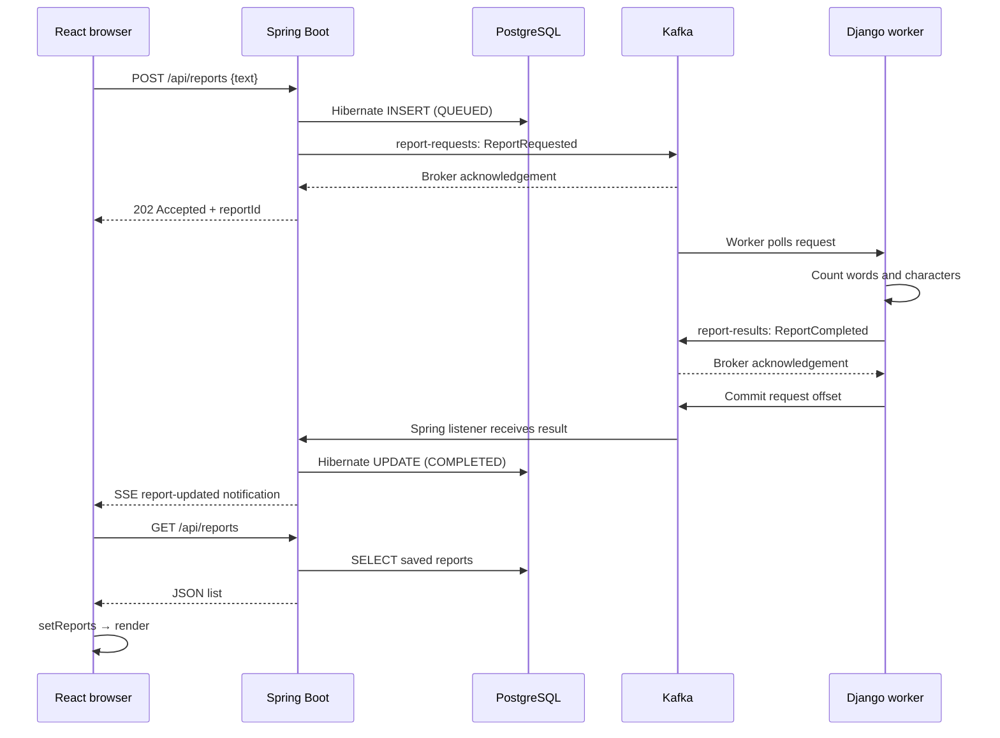

# Event Lab — learn one request, end to end

A small practice project using plain React (Vite, no full-stack React framework), Java 21 / Spring Boot 3.5, Spring Data JPA / Hibernate, PostgreSQL, Kafka, and a separate Django 5.2 worker.

**Start with the explanation below. You do not need to understand every file at once.**

## 1. The problem we are solving

Imagine a report takes 30 seconds. Holding an HTTP request open for all that time is inconvenient, and the API server should not have to do every kind of work itself. Instead:

1. React asks Spring Boot to create a report.
2. Spring saves a database row and sends a request message to Kafka.
3. Spring returns `202 Accepted` with the report ID. The report is not necessarily finished.
4. A separate Django process reads the message and does the work.
5. Django sends a completion message to Kafka.
6. Spring reads the completion, updates the database, and notifies connected browsers.
7. React fetches the saved result and updates its state, which redraws the UI.

Our report simply counts words and Unicode code points in text. Django waits three seconds so you can see the queued state. Word counting here means splitting on whitespace, not linguistic analysis. The work is deliberately trivial so you can concentrate on communication.



This diagram shows a typical ordering. Django can start work before React receives `202`; the two paths run independently.

## 2. What each technology actually does

| Piece | Its job in this project | Start reading here |
|---|---|---|
| React | Browser UI: form, HTTP requests, local component state, rendering | `frontend/src/main.jsx` |
| HTTP / REST | Request-response interface between browser and Java API | `ReportController.java` |
| Spring Boot | Starts and configures the Java application, web server and integrations | `Application.java`, `application.yml` |
| Controller | Maps HTTP URLs/methods to Java methods and validates input | `ReportController.java` |
| Service | Coordinates saving, publishing, and processing results | `ReportService.java` |
| Spring Data JPA | Provides repository methods such as `save` and `findById` | `ReportRepository.java` |
| JPA | Java specification for object-relational persistence | annotations on `Report.java` |
| Hibernate | Implements JPA; maps `Report` objects to rows and generates SQL | `Report.java`, JPA settings |
| JDBC driver | PostgreSQL-specific transport below Hibernate | PostgreSQL dependency in `pom.xml` |
| PostgreSQL | Durable storage for report status and results | `reports` table |
| Kafka broker | Stores message streams and serves them to consumers | `compose.yaml` |
| Django worker | Independent Python application that performs the work | `consume_reports.py`, `processing.py` |
| SSE | Long-lived HTTP connection carrying server-to-browser notifications | `BrowserEvents.java`, `EventSource` in React |
| Docker Compose | Starts the independent processes with a shared network | `compose.yaml` |

Hibernate is **not** the database and does not directly manage every part of connecting to it. The persistence path is roughly:

`Repository → JPA/Hibernate → JDBC + connection pool → PostgreSQL`

Spring's dependency injection creates components and supplies their constructor dependencies. You do not manually construct the controller's service or the service's repository. `@RestController`, `@Service`, and `@Configuration` help Spring discover their roles.

`@Entity` identifies a persistent Java class, `@Id` its primary key, and `@Column` a column constraint. The primary key is a UUID: it travels through both events so the result can be matched to the original row.

The Django application runs `python manage.py consume_reports`. Django supports custom management commands for standalone work. It does **not** need to run an HTTP server to consume Kafka, and it does not have access to Spring's database. Django itself does not speak Kafka: the `kafka-python` client does that.

## 3. Kafka vocabulary, with concrete examples

- **Broker:** the Kafka server. We run one for learning; production clusters commonly use several.
- **Topic:** a named stream. We have `report-requests` and `report-results`.
- **Producer:** a client that writes records. Spring produces requests; Django produces results.
- **Consumer:** a client that reads records. Django consumes requests; Spring consumes results. Consumers poll; Kafka is not making HTTP calls into Django.
- **Record/message:** a key, value, and metadata. Our value is JSON; our key is the report UUID.
- **Partition:** a topic's ordered log. We use one partition per topic. More partitions allow more consumers in one group to work concurrently; ordering is guaranteed within a partition, not across a whole multi-partition topic.
- **Offset:** a record's position in one partition. A committed offset records where a consumer group should resume.
- **Consumer group:** workers cooperating under one name. `django-report-workers` shares request work; `spring-report-results` consumes results. Within a group, a partition has one active consumer. A different group can independently read the same topic.
- **Acknowledgement:** confirmation of a particular operation. A producer acknowledgement means Kafka accepted the record according to its settings; it does not mean Django finished the business work.
- **Retention:** Kafka keeps records according to policy. Consuming a record does not delete it. Replay is possible while records remain available.
- **Lag:** how far a consumer group is behind the latest records.

The request is semantically a **command** asking for work, even though it travels in an event-based system. `ReportCompleted` describes something that already happened. Both are messages carried by Kafka.

An event contract is the agreed JSON shape, independent of Java and Python classes:

```json
{"type":"ReportRequested","version":1,"reportId":"a-uuid","text":"Hello from React"}
```

```json
{"type":"ReportCompleted","version":1,"reportId":"a-uuid","wordCount":3,"characterCount":16}
```

The `version` supports future contract changes. Both sides must agree on field names, meanings, types, and compatibility rules. JSON strings avoid requiring Python to understand Java-specific class metadata.

## 4. Why the browser needs another connection

Kafka does not automatically update a web page. Spring receiving a Kafka event and React receiving a browser notification are separate steps.

We use **Server-Sent Events**, a one-way stream over HTTP. React's `EventSource` subscribes to `/api/reports/events`. Spring sends `report-updated`, and React fetches the database-backed list. The stream sends a small notification, not the complete report.

Other choices are polling (repeat GETs on a timer) and WebSockets (two-way communication). This demo also fetches every 15 seconds and on SSE reconnect to recover from missed notifications. SSE is not durable here; PostgreSQL is the source of truth. React's `setReports` changes component state, triggering rendering. Spring never directly edits browser DOM elements.

Nginx serves the built React files and proxies `/api` to Spring. This gives the browser one origin and disables buffering for SSE. Nginx is infrastructure, not another business service.

## 5. Run it

You need Docker Desktop running, with Docker Compose. Host Java, Maven, Node and Python installations are unnecessary: builds run inside containers. Initial builds need internet access and can take several minutes. Ports 15173 and 18080 must be free.

From this project directory:

```bash
docker compose up -d --build
docker compose ps
```

Open **http://localhost:15173**. Submit text and watch `QUEUED` become `COMPLETED`. API health is at **http://localhost:18080/actuator/health**.

Follow the useful logs:

```bash
docker compose logs -f backend worker
```

Look for the same `reportId` in both services. Only browser/API ports are published, bound to localhost. Kafka and PostgreSQL are available on the private Compose network under the service names `kafka` and `db`.

Stop without deleting data:

```bash
docker compose down
```

For a completely clean practice reset, `docker compose down -v` **deletes this project's database and Kafka volumes**. Do not use it if you want to keep your reports.

## 6. Learn in this order

### Exercise A — follow HTTP first

Read React's `submit`, then the controller's `request` method. Open your browser's Network tab, submit once, and inspect the POST body and `202` response. Notice that receiving the HTTP response and completing the work are different events.

### Exercise B — see the database mapping

Read `Report.java`, then `ReportRepository.java`. Inspect the stored rows:

```bash
docker compose exec db psql -U learner -d eventlab -c 'select id, status, word_count, character_count from reports;'
```

Notice that Python's worker never runs SQL against this database. To see generated SQL, temporarily add `show-sql: true` under `spring.jpa` and rebuild the backend.

### Exercise C — look inside Kafka

Print requests from the beginning of the retained log. This observer does not replace the Django consumer:

```bash
docker compose exec kafka /opt/kafka/bin/kafka-console-consumer.sh --bootstrap-server kafka:9092 --topic report-requests --from-beginning --property print.key=true
```

Use Ctrl-C to exit. Change `report-requests` to `report-results` to inspect completion messages. Topic output contains the text you submitted; use sample data.

### Exercise D — prove the services are independent

```bash
docker compose stop worker
```

Submit another report. The API still accepts it; it remains queued. Kafka stores the request while the worker is offline.

```bash
docker compose start worker
```

The worker resumes and finishes the report. Inspect its consumer group's offsets and lag:

```bash
docker compose exec kafka /opt/kafka/bin/kafka-consumer-groups.sh --bootstrap-server kafka:9092 --describe --group django-report-workers
```

### Exercise E — follow the return path

Read `make_result`, then `producer.send`, then Spring's `@KafkaListener`, then `ReportService.complete`, then `BrowserEvents.changed`. Finally find React's `report-updated` listener. This is the part that connects backend processing to the UI.

Use the browser Network tab to inspect the persistent `/events` response. Reload the page: completed results return from PostgreSQL even though old SSE notifications are gone.

### Exercise F — make one small change yourself

Add `lineCount` to the worker's result, Spring's entity and result handler, and React's report card. You will change an event contract, a persistence model, and a UI representation. Rebuild with `docker compose up -d --build`.

### Exercise G — explore retries after understanding the happy path

Stop Kafka, then submit a request. The API cannot confirm publication and returns an error; a `QUEUED` database row may already exist. Restart Kafka. That row is not automatically republished. This demonstrates the database/message **dual-write problem** described below. A Kafka send timeout is ambiguous: the broker may have accepted a record even if the producer did not receive confirmation.

## 7. Delivery and failure behavior — learning limits

This is a local teaching project, not a production template.

- **At-least-once processing:** Django commits its request offset only after its result is acknowledged. A crash after publication but before offset commit can deliver the request again. The word-count action is safe to repeat, and Spring ignores changes to an already completed report. This does not provide end-to-end exactly-once processing.
- **Database + Kafka dual write:** saving the request and sending Kafka are separate operations. A crash between them can leave a queued row with no message. A production approach is a transactional outbox: save the business row and an outgoing-event row in one DB transaction, then relay unsent events with retries. The relay can still publish duplicates, so consumers must remain idempotent.
- **Browser notification timing:** Spring commits the result before sending SSE. If it crashes before notifying, reload/reconnect or periodic reconciliation retrieves the saved result.
- **Malformed messages:** the worker exits rather than committing failed work. Spring retries handler failures. There is no dead-letter topic, operator retry UI, or poison-message recovery workflow. Add bounded retries and a dead-letter topic as a later exercise.
- **Single instances:** one broker, one partition per topic, one backend, one worker. Multiple Spring instances would need a design that routes notifications to the instance holding a user's SSE connection. Consumer groups alone do not broadcast to every browser-connected instance.
- **Schema:** `ddl-auto: update` makes Hibernate update the practice schema. Use explicit database migrations for a real system.
- **Security and scale:** no authentication, per-user ownership, encryption, rate limits, pagination, or production secret management. All browsers see all demo reports. Use only local sample text. Single-broker `acks=all` is not redundancy.
- **Versions:** this uses a deliberate Spring Boot 3.5 baseline, not a claim about your company's version. Django is constrained to the 5.2 series; its exact patch is resolved at build time. Align versions with your team later.

## 8. Verification

With the stack running:

```bash
python3 scripts/smoke.py
docker compose exec worker python -m unittest reports.test_processing -v
```

Verified locally on 16 November 2026: container builds and startup; the real Kafka request/result round trip; HTTP input validation; SSE notifications; the React form completing automatically; three worker unit tests; and a request queued while Django was stopped completing after its restart. These are local checks, not production validation.

The one-shot `kafka-volume-init` container exiting successfully is expected: it gives the Kafka user permission to write the named data volume.

The smoke test creates a report, waits for the real worker's result, checks counts and the matching SSE notification, and checks that blank text is rejected. It leaves the test report in the database so you can inspect it.

## 9. Questions to bring to your new team

1. Which service owns each database/table and each event contract?
2. Which topics and consumer groups does my service use?
3. How do we handle retries, dead-letter messages and duplicate delivery?
4. Do we use an outbox or another way to coordinate database writes with events?
5. Does the UI use polling, SSE or WebSockets?
6. How do we trace one request across services, and where do we inspect consumer lag?

## Official references

- [Spring Boot](https://docs.spring.io/spring-boot/3.5/index.html): application configuration and integrations.
- [Spring Data JPA](https://docs.spring.io/spring-data/jpa/reference/): repository abstraction.
- [Apache Kafka quickstart](https://kafka.apache.org/quickstart/): topics, producing and consuming.
- [Kafka Docker guide](https://kafka.apache.org/41/getting-started/docker/): official container setup.
- [Django custom management commands](https://docs.djangoproject.com/en/5.2/howto/custom-management-commands/): running the worker as a Django command.
- [React state](https://react.dev/learn/state-a-components-memory): state changes and rendering.
